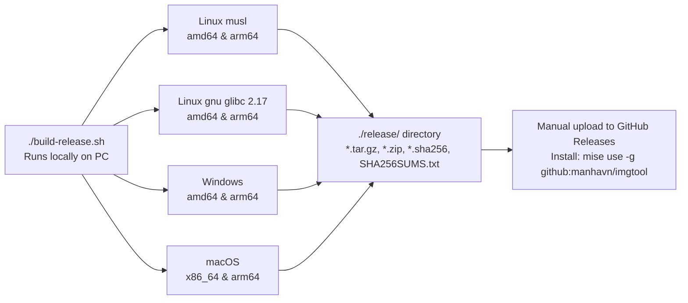

# `imgtool` Implementation Plan (Rust `eframe` Image Viewer & Quick Annotation Tool)

## 1. Project Goals
Build a fast image viewer and quick annotation/editing tool (`imgtool`) written in **Rust (`eframe`/`egui`)**, inspired by **KDE `ksnip`**:
- **No screen capture feature** — 100% focused on instantly opening existing images (from a file manager, CLI, drag-and-drop, or pasted from the Clipboard), quickly drawing annotations / redacting sensitive info, and **saving as a new file** or **copying to the clipboard** for immediate sharing.
- **Set as Default Image Viewer/Opener** on the current desktop (Ubuntu/Linux Wayland & X11) as well as supporting registration on Windows and macOS.
- **Cross-platform installation via `mise`** (`mise use -g github:manhavn/imgtool`) for **Linux (`musl` & `gnu` for `amd64`/`arm64`)**, **Windows (`amd64`/`arm64`)**, and **macOS (`x86_64`/`arm64`)**.
- **All-English Mandate**: All project documentation (`PLAN.md`, `README.md`), source code, comments, UI labels/tooltips, CLI `--help` output, and build script messages must be written **100% in English**.
- **`README.md` Installation Command**: The `README.md` must prominently document the installation command:
  ```bash
  mise use -g github:manhavn/imgtool
  ```
- **100% Local Release Build (`./build-release.sh` -> `./release/`)**: Strictly **no GitHub Actions CI**. All release artifacts are cross-compiled directly on the local PC through a single script, outputting all compressed archives + checksums into `./release/` for local verification and manual upload to GitHub Releases.

---

## 2. Technical Architecture & Crates

| Component | Crate / Solution | Rationale |
|---|---|---|
| **GUI & Renderer** | `eframe` + `egui` (features: `glow`, `wayland`, `x11`, `default_fonts`) | Pure Rust + OpenGL/EGL (`glow`), no GTK/Qt build or runtime dependencies, instant startup (<50ms), smooth execution on Wayland, X11, Windows, and macOS. |
| **Image Processing** | `image` (features: `png`, `jpeg`, `webp`, `gif`, `bmp`, `ico`, `tiff`) | Pure-Rust multi-format decoding/encoding (no system C library dependencies), lossless/high-quality export. |
| **Vector Drawing & Native-Resolution Rasterizer** | `egui::Painter` (viewport preview) + 2D software rasterizer on `image::RgbaImage` (`ab_glyph` / internal rasterizer) | When saving a new file or copying to the clipboard, annotations are rendered directly at the 1:1 native pixel resolution of the image (never blurred or scaled by screen zoom). |
| **Clipboard** | `arboard` (+ `wl-copy` fallback on Linux Wayland) | Supports `Ctrl+C` (copy edited image to clipboard for pasting directly into Telegram/Slack/Discord/Browser) and `Ctrl+V` (paste image from clipboard to edit). Preserves clipboard contents on Wayland even after closing the app. |
| **File Dialogs** | `rfd` (or built-in path picker fallback) | Native `Save As...` and `Open...` dialogs without hard GTK3 dependencies. |

---

## 3. Image Viewing & Annotation Features (`ksnip` Style)

### 3.1. Fast Workflow
1. **Open Image**:
   - Double-click an image file in the system file manager (Nautilus/Dolphin/Explorer/Finder) -> opens immediately in `imgtool`.
   - Run `imgtool <image-path>`.
   - Launch empty `imgtool` and press `Ctrl+V` (paste screenshot/image from clipboard) or Drag & Drop an image file into the window.
2. **View & Navigate as Default Image Viewer**:
   - **Zoom & Pan**: Mouse wheel (`Scroll` / `Ctrl+Scroll`) to zoom centered at the cursor, middle-click drag (or `Space + Left-Click drag`) to pan, plus `Fit to Window` (`F`) and `100%` (`1`) controls.
   - **Folder Navigation**: Arrow keys `◀` / `▶` (or toolbar buttons when not editing text) to quickly cycle through sibling images in the same directory.
3. **Non-Destructive Object Layer**:
   - Every stroke/shape is stored as an independent annotation object in the layer/history stack, allowing users to select, move, resize, recolor, or delete existing annotations at any time before exporting.

### 3.2. Annotation & Image Tools
| Shortcut | Tool | Detailed Behavior (`ksnip` standard) |
|---|---|---|
| `V` / `Esc` | **Select / Move** | Click any drawn annotation object to move it, drag resize handles, change color/stroke width, or press `Delete`/`Backspace` to remove it. |
| `P` | **Pen (Freehand)** | Freehand drawing with stroke smoothing (Catmull-Rom / Bezier smoothing). |
| `H` | **Highlighter** | Semi-transparent marker stroke (alpha ~40%) for highlighting text or UI regions. |
| `A` | **Arrow** | Click-and-drag directional arrows (sharp arrowhead in ksnip style, adjustable thickness and color). |
| `L` | **Line** | Straight line segment (hold `Shift` to snap angles to 0°/45°/90°). |
| `R` | **Rectangle** | Outlined or semi-transparent filled rectangle for framing UI areas or bugs. |
| `E` | **Ellipse / Circle** | Outlined or semi-transparent filled ellipse (hold `Shift` for a perfect circle). |
| `T` | **Text** | Click on the canvas to type UTF-8 text directly, with adjustable font size, color, and optional semi-transparent background callout box for readability. |
| `N` | **Number Stamp** | Single-click to place auto-incrementing numbered badges (`1`, `2`, `3`...) — signature `ksnip` feature for step-by-step guides. |
| `B` / `X` | **Blur / Pixelate (Redact)** | Drag over a region to pixelate/blur or black-out sensitive information (passwords, API keys, emails, phone numbers) before sharing. |
| `C` | **Crop** | Interactive crop rectangle with dimmed outside overlay and live `W × H px` badge; press `Enter` to apply or `Esc` to cancel (fully Undoable). |
| — | **Rotate / Flip / Padding** | Rotate 90° left/right, flip horizontal/vertical, and **Expand Canvas (Add Margin/Padding)** around the image to create extra space for external callout notes like `ksnip`. |

### 3.3. History & Export (Output / Send)
- **Undo / Redo**: `Ctrl+Z` / `Ctrl+Y` (or `Ctrl+Shift+Z`) covering both vector annotations and canvas transforms (Crop/Rotate/Flip/Padding).
- **Quick Save New File (`Ctrl+S`)**:
  - Immediately saves as a **new file** in the same folder as the original image using the pattern `<original-stem>_edited_<YYYYMMDD_HHMMSS>.png` (never overwriting the original image), showing a status toast and a button to reveal the file in the folder.
- **Save As... (`Ctrl+Shift+S`)**:
  - Opens a save dialog to choose directory, file name, and export format (`PNG`, `JPEG`, `WebP`).
- **Copy to Clipboard (`Ctrl+C`)**:
  - Renders the annotated image at full resolution directly into the system clipboard so it can be pasted (`Ctrl+V`) into chat apps or browsers without saving temporary files.

---

## 4. Default Image Viewer Integration

Supported via both an **in-app GUI button** (`Set as Default Image Viewer`) and **CLI flags** (`imgtool --install-desktop` / `imgtool --uninstall-desktop`):

### 4.1. `mise`-Compatible `stable_path` Mechanism (Always Use Shims to Prevent Broken Paths on Upgrade)
- **Critical Upgrade-Safety Rule**: When installed via `mise use -g github:manhavn/imgtool`, the actual binary is placed inside a versioned directory (`~/.local/share/mise/installs/github-manhavn-imgtool/<version>/imgtool` or `~/.local/share/mise/installs/github-manhavn-imgtool/<version>/bin/imgtool`). Whenever a user upgrades to a new version and prunes or replaces old versions (`mise upgrade` / `mise prune`), the old `<version>` directory is removed — causing "missing executable / failed to launch" errors if any `.desktop` entry, file-manager "Open With" association, shortcut, or custom launcher points directly to `std::env::current_exe()`.
- **Mandatory Shims Resolution (`stable_path`)**: When registering or invoking the app for desktop/file-opener integration, `imgtool` **must never write the versioned install path**. Instead, it detects the `mise` installation layout and resolves `Exec=` / launcher commands to the **`mise` shim path** first:
  1. **Linux / macOS**: `~/.local/share/mise/shims/imgtool` (or `$MISE_DATA_DIR/shims/imgtool`) — **Primary & strongly recommended** because `mise` shims automatically resolve to whichever version is currently active, even across upgrades and version removals.
  2. **Windows**: `%LOCALAPPDATA%\mise\shims\imgtool.exe` (or `%USERPROFILE%\AppData\Local\mise\shims\imgtool.exe`).
  3. **Fallback (`latest` symlink)**: `~/.local/share/mise/installs/github-manhavn-imgtool/latest/imgtool` only if the `shims` binary does not exist.
- **Self-Healing Startup Check (`refresh_exec_path`)**: On every application startup, `imgtool` inspects existing desktop registrations (`.desktop` on Linux, Registry on Windows, `ImgTool.app` wrapper on macOS). If an entry still points to a version-specific `/installs/.../<version>/` path or a stale binary path, `imgtool` automatically rewrites it to the `mise` shim path (`~/.local/share/mise/shims/imgtool`).

### 4.2. Per-OS Registration (Using `mise` Shims Path)
1. **Linux (Ubuntu GNOME Wayland/X11, KDE, XFCE, ...)**:
   - Installs application icons at `~/.local/share/icons/hicolor/scalable/apps/imgtool.svg` and `128x128/apps/imgtool.png`.
   - Writes `~/.local/share/applications/imgtool.desktop` using the shim path:
     - `Exec=/home/<user>/.local/share/mise/shims/imgtool %F` (resolved via `stable_path`)
     - `TryExec=/home/<user>/.local/share/mise/shims/imgtool`
     - `MimeType=image/png;image/jpeg;image/webp;image/gif;image/bmp;image/tiff;image/x-icon;`
   - Runs `xdg-mime default imgtool.desktop <mime>` for all common image MIME types and updates `~/.config/mimeapps.list` (`[Default Applications]` & `[Added Associations]`), making `imgtool` the default image opener immediately and keeping it working across all future `mise` upgrades.
2. **Windows**:
   - Registers `<shim_path> "%1"` (pointing to `%LOCALAPPDATA%\mise\shims\imgtool.exe`) under `HKCU\Software\Classes\Applications\imgtool.exe\shell\open\command` and adds `OpenWithProgids` for `.png`, `.jpg`, `.jpeg`, `.webp`, `.bmp`, `.gif`, `.ico`, `.tiff` (no Administrator privileges required).
3. **macOS**:
   - Creates a lightweight `~/Applications/ImgTool.app` bundle (`Contents/Info.plist` declaring `CFBundleDocumentTypes` for `public.image` and a launcher script that executes `~/.local/share/mise/shims/imgtool "$@"`) so Finder lists `ImgTool` in *Open With* / *Get Info -> Change All* without breaking when `mise` upgrades versions.
---

## 5. Local Release Build (`./build-release.sh` -> `./release/`) & `mise` Distribution

### 5.1. Core Principles ("One Run Does Everything")
- **No GitHub Actions / CI**: No `.github/workflows`. All compilation runs locally using the host PC's CPU.
- **Single `./build-release.sh` Script — Builds All Variants in One Run**:
  - Automatically detects, configures, and installs any missing tools/SDKs before building.
  - Compiles all 8 target variants (Linux `musl` amd64/arm64, Linux `gnu` amd64/arm64, Windows amd64/arm64, macOS x86_64/arm64), packages `.tar.gz`/`.zip`, and generates `.sha256` files plus `SHA256SUMS.txt`.
  - Outputs all final artifacts into **`./release/`** (cleaning stale artifacts before publishing new ones).
  - Prints ready-to-run `gh release create` / `gh release upload` commands for `manhavn/imgtool` at the end of the build.

### 5.2. Automatic Missing-Tool Bootstrap (Priority: `mise` -> Userspace -> `sudo` Handling)
When running `./build-release.sh`, if any required tool is missing, the script automatically resolves it in the following strict priority order so **root privileges are avoided** and **a single run succeeds**:

1. **Priority 1 — Auto-install via `mise` (Userspace, no `sudo`)**:
   - **`mise`**: If `mise` is not installed, automatically installs it via `curl -fsSL https://mise.run | sh` into `~/.local/bin/mise` and adds shims to `PATH`.
   - **`zig`**: If `zig` is missing, runs `mise use -g zig@0.13.0`.
   - **`rust` (`cargo` / `rustc` / `rustup`)**: If missing, runs `mise use -g rust@latest`.
   - **`python3`**: If `python3` is missing (used for portable `.zip` creation, linker flag filtering, and loader downloads), runs `mise use -g python@latest`.
   - **Host C Compiler (`cc`)**: If `cc`/`gcc`/`clang` is missing, runs `mise use -g clang@latest` or creates a userspace `cc` wrapper delegating to `zig cc` so `build.rs` scripts compile without requiring `apt install build-essential`.

2. **Priority 2 — Auto-download Binaries / Targets / SDKs into `$HOME` (Userspace Fallback)**:
   - **`cargo-zigbuild`**: If missing, installs via `mise use -g cargo:cargo-zigbuild` or downloads the prebuilt binary into `~/.cargo/bin/`, falling back to `cargo install cargo-zigbuild --locked`.
   - **Rust Targets**: Automatically runs `rustup target add` for all 8 targets (`x86_64-unknown-linux-musl`, `aarch64-unknown-linux-musl`, `x86_64-unknown-linux-gnu`, `aarch64-unknown-linux-gnu`, `x86_64-pc-windows-gnu`, `aarch64-pc-windows-gnullvm`, `x86_64-apple-darwin`, `aarch64-apple-darwin`).
   - **Alpine `ld-musl` Loader (`x86_64` & `aarch64`)**: Automatically downloads into `.build-cache/musl/` and verifies SHA256 checksums for dynamic `musl` linking.
   - **macOS SDK (`MacOSX.sdk`) on Linux hosts**: Checks `$SDKROOT`, `~/.sdk`, `~/.local/macos-sdk`. If absent on Linux, automatically downloads and extracts `MacOSX.sdk` (headers & `.tbd` framework stubs with SHA256 verification) into `~/.local/macos-sdk/` and sets `SDKROOT` so `cargo-zigbuild` compiles both macOS targets (`x86_64-apple-darwin` & `aarch64-apple-darwin`) on the first run.

3. **Priority 3 — System Packages & `sudo` Policy (No Interactive Hang -> Print Command & Exit Immediately)**:
   - If a required dependency can only be installed via a system package manager (`apt`, `dnf`, `pacman`, `zypper`, `apk`) and is unavailable via `mise` or userspace download:
     - If running as `root` (`EUID == 0`) or passwordless sudo (`sudo -n true`) is available: automatically installs the package.
     - **If `sudo` requires a password or the user lacks sudo privileges**: the script **never blocks waiting for a password prompt**; instead, it immediately **prints a clear error message with the exact command to run** (e.g., `sudo apt-get update && sudo apt-get install -y <package>`) and **exits immediately (`exit 1`)**.

### 5.3. Technical Note on `eframe` for Linux `musl` vs `gnu`
- `eframe` (via `winit` and `glutin`/`glow`) calls `dlopen()` at runtime to load GPU drivers (`libEGL.so.1`, `libGLX.so.0`) and display libraries (`libwayland-client.so.0`, `libX11.so.6`, `libxkbcommon.so.0`).
- In default static `musl` builds (`+crt-static`), `musl`'s `dlopen()` is a stub that always fails with `Dynamic loading not supported`, preventing GUI window creation.
- **Solution**:
  1. **`musl` Variants (`x86_64-unknown-linux-musl` & `aarch64-unknown-linux-musl`)**:
     - Compiled via `cargo-zigbuild` with `-C target-feature=-crt-static` and linked against the dynamic loader `ld-musl-<arch>.so.1` (downloaded and SHA256-verified from Alpine `musl-1.2.5`). This allows `musl` binaries to call `dlopen()` and open GUI windows on `musl` distributions (Alpine, Void musl, Chimera, etc.).
  2. **`gnu` Variants (`x86_64-unknown-linux-gnu` & `aarch64-unknown-linux-gnu`)**:
     - Compiled via `cargo-zigbuild` pinned to **`glibc 2.17`** (`x86_64-unknown-linux-gnu.2.17` and `aarch64-unknown-linux-gnu.2.17`).
     - On `glibc`-based Linux distributions (Ubuntu, Debian, Fedora, Arch, etc.) where GPU drivers (`Mesa`/`NVIDIA`) are linked against `glibc`, running `mise use -g github:manhavn/imgtool` automatically selects the `gnu` build on `glibc` systems and the `musl` build on `musl` systems — ensuring out-of-the-box compatibility across **all** Linux distributions on both `amd64` and `arm64`.

### 5.4. Release Artifact Matrix in `./release/`



| OS | Architecture | Rust Target | Output File in `./release/` | Local Cross-Compile Toolchain |
|---|---|---|---|---|
| **Linux (musl)** | `amd64` (x86_64) | `x86_64-unknown-linux-musl` | `imgtool-x86_64-unknown-linux-musl.tar.gz` | `cargo-zigbuild` + dynamic `ld-musl` loader |
| **Linux (musl)** | `arm64` (aarch64) | `aarch64-unknown-linux-musl` | `imgtool-aarch64-unknown-linux-musl.tar.gz` | `cargo-zigbuild` + dynamic `ld-musl` loader |
| **Linux (gnu)** | `amd64` (x86_64) | `x86_64-unknown-linux-gnu` | `imgtool-x86_64-unknown-linux-gnu.tar.gz` | `cargo-zigbuild` (`glibc 2.17` floor) |
| **Linux (gnu)** | `arm64` (aarch64) | `aarch64-unknown-linux-gnu` | `imgtool-aarch64-unknown-linux-gnu.tar.gz` | `cargo-zigbuild` (`glibc 2.17` floor) |
| **Windows** | `amd64` (x86_64) | `x86_64-pc-windows-gnu` *(or `msvc`)* | `imgtool-x86_64-pc-windows-gnu.zip` | `cargo-zigbuild` (or `cargo-xwin` if `msvc` enabled) |
| **Windows** | `arm64` (aarch64) | `aarch64-pc-windows-gnullvm` | `imgtool-aarch64-pc-windows-gnullvm.zip` | `cargo-zigbuild` (Zig LLVM) |
| **macOS** | `Intel` (x86_64) | `x86_64-apple-darwin` | `imgtool-x86_64-apple-darwin.tar.gz` | `cargo-zigbuild` (with `SDKROOT` on Linux PC or native Mac) |
| **macOS** | `Apple Silicon` | `aarch64-apple-darwin` | `imgtool-aarch64-apple-darwin.tar.gz` | `cargo-zigbuild` (with `SDKROOT` on Linux PC or native Mac) |

*(Supports `TARGETS=... ./build-release.sh` environment override when building a specific subset of targets).*

---

## 6. Project Directory Structure & `README.md` Specification

```text
imgtool/
├── Cargo.toml
├── PLAN.md                     # This implementation plan (in English)
├── README.md                   # English documentation featuring `mise use -g github:manhavn/imgtool`
├── build-release.sh            # Single local release build script -> outputs to ./release/
├── scripts/
│   ├── zig-linker.py           # Wrapper filtering incompatible -Wl,-O1 flags when invoking zig cc/c++
│   └── musl-runtime.py         # Downloads & SHA256-verifies ld-musl loaders for dynamic musl GUI builds
├── assets/
│   └── icon.svg                # Application vector icon (embedded into the binary)
├── src/
│   ├── main.rs                 # Entry point, CLI argument parser (--help, --version, --install-desktop, file path)
│   ├── app.rs                  # Main eframe::App state, Top Toolbar, Side/Bottom Bar, Canvas layout
│   ├── canvas.rs               # Image viewport rendering, Zoom/Pan, screen <-> native image pixel coordinate mapping
│   ├── annotations.rs          # Annotation models (Pen, Arrow, Line, Rect, Ellipse, Text, NumberStamp, Blur)
│   ├── render.rs               # 1:1 native-resolution software rasterizer combining base image + annotations into RgbaImage
│   ├── history.rs              # Undo / Redo stack for both vector annotations and canvas transforms (Crop, Rotate, Padding)
│   ├── io.rs                   # Image loading/saving, Quick Save new file, sibling folder navigation, Clipboard
│   ├── desktop.rs              # Default image viewer installer/uninstaller (Linux .desktop/mimeapps, Windows, macOS + mise stable_path)
│   └── icon.rs                 # Embedded icon decoder for eframe window and desktop integration
└── release/                    # Generated .tar.gz, .zip, .sha256, and SHA256SUMS.txt ready for GitHub Releases
```

### `README.md` Requirements (English Only)
- Written completely in **English**.
- Includes a **Quick Install** section at the top with the exact `mise` command:
  ```bash
  mise use -g github:manhavn/imgtool
  ```
- Documents how to register `imgtool` as the default system image viewer (`imgtool --install-desktop` or via the GUI button), and includes an explicit note explaining that custom desktop launchers, keybindings, or "Open With" commands should always invoke the **`mise` shim path** (`~/.local/share/mise/shims/imgtool` on Linux/macOS, `%LOCALAPPDATA%\mise\shims\imgtool.exe` on Windows) rather than the versioned `~/.local/share/mise/installs/.../<version>/` directory so upgrades never break the launcher path.
- Lists keyboard shortcuts, annotation tools, CLI options, and instructions for running `./build-release.sh`.

---

## 7. Implementation Roadmap (Upon Plan Approval)

1. **Step 1 — Project Initialization & Core Rendering Engine (`render.rs`, `annotations.rs`, `history.rs`)**:
   - Configure `Cargo.toml` with `eframe`, `egui`, `image`, `arboard`, `rfd`.
   - Implement data structures for all annotation tools (`Arrow`, `Pen`, `Highlighter`, `Rect`, `Ellipse`, `Text`, `NumberStamp`, `Blur/Pixelate`) and image transforms (`Crop`, `Rotate`, `Flip`, `ExpandCanvas`).
   - Implement `render_final_image()` to rasterize annotations at 1:1 native image resolution.
2. **Step 2 — `eframe` GUI & Workflow (`app.rs`, `canvas.rs`, `io.rs`)**:
   - Build the `ksnip`-inspired toolbar (all UI strings in English): tool selector, quick color palette, stroke width / font size sliders, Undo/Redo, Crop, Rotate, Expand Canvas, Quick Save (`Ctrl+S`), Save As (`Ctrl+Shift+S`), Copy (`Ctrl+C`), and Set Default Viewer.
   - Implement keyboard shortcuts, cursor-centered Zoom/Pan, interactive object selection/move/resize, and folder prev/next navigation.
3. **Step 3 — OS Integration & `mise` Support (`desktop.rs`)**:
   - Implement `--install-desktop` / `--uninstall-desktop` and the GUI integration button using the `mise` `stable_path` resolution (`github-manhavn-imgtool`).
4. **Step 4 — Automated Local Release Build (`build-release.sh`, `scripts/`, & `README.md`)**:
   - Write `./build-release.sh` with automatic missing-tool provisioning (`mise` priority, userspace SDK/binary fallback, non-interactive `sudo -n` check that prints exact install commands and exits if root permissions are required).
   - Write `README.md` in English featuring `mise use -g github:manhavn/imgtool`.
5. **Step 5 — Smoke Testing & Release Verification**:
   - Run unit tests for the renderer and desktop path resolver, and run `./build-release.sh` to verify all release archives in `./release/`.
